<div align="center">


# NewTab Dashboard

**Your new Firefox tab, finally useful.**<br>
Links, news, videos, markets, the weather and your homelab status in a minimal, fully configurable panel.

<br>

[](https://addons.mozilla.org/en-US/firefox/addon/newtab-dashboard/)

[](https://github.com/fmartineze/newtab-dashboard/releases/latest)
[](LICENSE)


[🇷🇺 Русский](README.ru.md) · **🇬🇧 English** · [🇪🇸 Español](README.md)

<br>

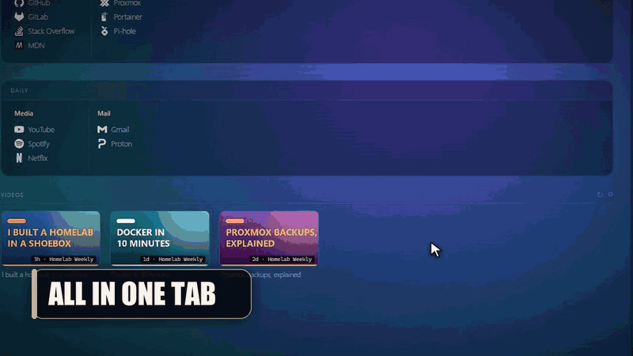

</div>

<br>

<p align="center">
  <a href="#what-it-is">What it is</a> ·
  <a href="#tour">Tour</a> ·
  <a href="#features">Features</a> ·
  <a href="#install">Install</a> ·
  <a href="#first-steps">First steps</a> ·
  <a href="#customization">Customization</a> ·
  <a href="#tech">Tech</a>
</p>

---

<a id="what-it-is"></a>
## 🧭 What it is

**NewTab Dashboard** replaces Firefox's new tab with an elegant, minimal personal panel that keeps everything you check every day within reach. It runs entirely in your browser: **no servers of its own, no accounts, no API keys and no telemetry**.

<table>
  <tr>
    <td width="33%" valign="top">
      <h4>🔗 Your links</h4>
      Sections → groups → links that you reorder by <b>dragging</b>, with automatic icons.
    </td>
    <td width="33%" valign="top">
      <h4>🧭 Toolbar menu</h4>
      A Firefox icon opens your organized links, with <b>search</b> and keyboard support.
    </td>
    <td width="33%" valign="top">
      <h4>🖼️ Any background</h4>
      Gradients, <b>Wallhaven</b>, the <b>Bing</b> daily image or your own picture.
    </td>
  </tr>
  <tr>
    <td valign="top">
      <h4>▶️ YouTube</h4>
      The latest videos from your channels, no Google API key needed.
    </td>
    <td valign="top">
      <h4>📈 Markets and 🌦️ weather</h4>
      Live crypto prices and a forecast for your city with <b>animated icons</b>.
    </td>
    <td valign="top">
      <h4>🖥️ Your homelab</h4>
      <b>Uptime Kuma</b>, <b>Proxmox</b>, <b>Docker</b> (Portainer) and <b>Pi-hole</b> at a glance.
    </td>
  </tr>
</table>

---

<a id="tour"></a>
## 📸 Tour

### Everything in one tab

<p align="center">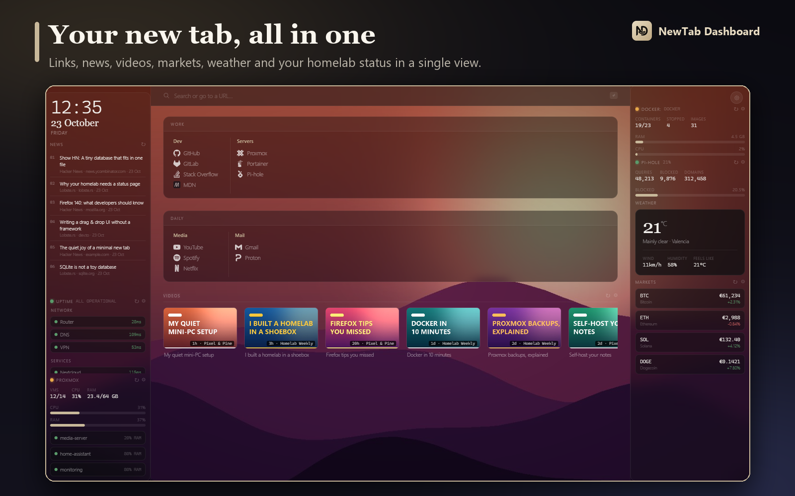</p>

The dashboard is laid out in three columns:

| | |
|---|---|
| **Left** | Clock and date, **RSS news** and your homelab monitors (Uptime Kuma, Proxmox) |
| **Center** | Search bar with 8 engines, your **links** by section and group, and the YouTube **videos** |
| **Right** | **Weather**, calendar, **markets**, Docker, Pi-hole and a notepad |

And it's *yours*: every widget can be turned on, turned off and placed wherever you like.

### Your links, your way

<p align="center">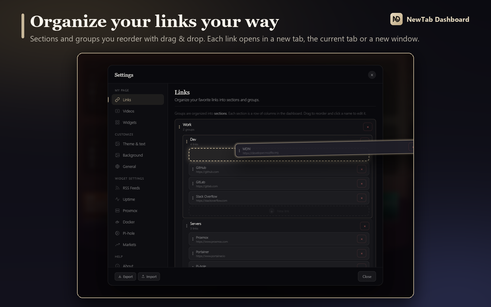</p>

- Clear structure: **Sections → Groups → Links**, with automatic icons.
- **Drag & drop** to reorder links, groups and sections: an animated gap opens where the item will land. You can also move a link to another group.
- **Click a name** to edit it. The dashed slots show where something can be added.
- Each link opens where you choose: **a new tab, the current tab or a new window**.

### Toolbar menu

<p align="center">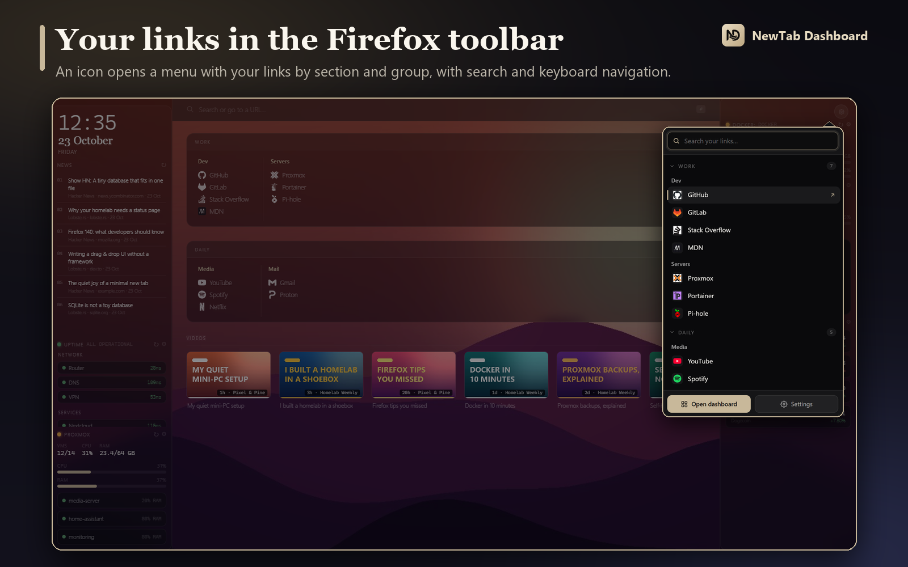</p>

- A **toolbar icon** opens a menu with your links organized by section and group (sections collapse and remember their state).
- **Search** is focused as soon as it opens: it filters by name, address, group or section and highlights what it finds.
- **Keyboard**: `↑` `↓` to move, `Enter` to open, `Esc` to clear the search or close; just start typing.
- `Shift`+click opens a new window; `Ctrl`+click or middle-click opens a background tab without closing the menu.
- Turn it on or off with the switch in **Settings → Links**, which also explains how to pin the icon to the toolbar.

### Any background, in one click

<p align="center">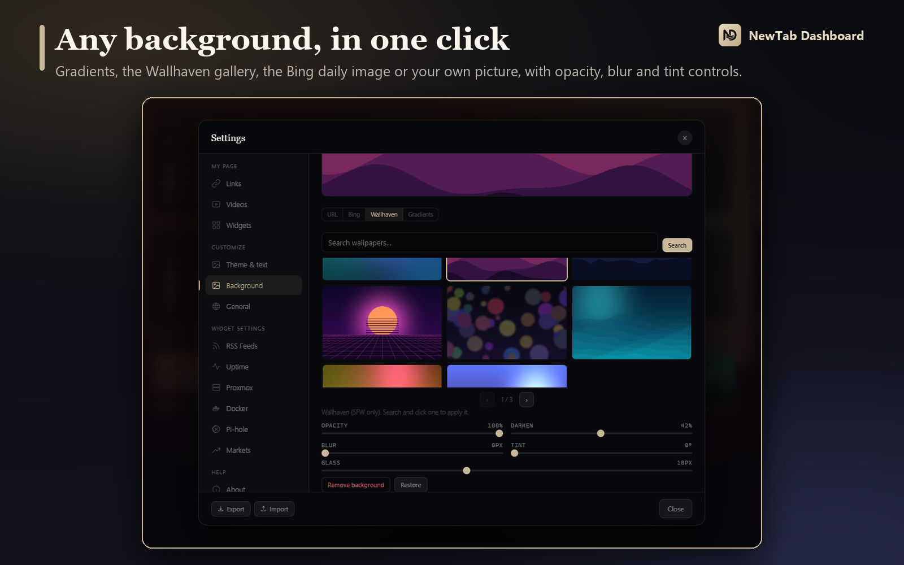</p>

Preset **gradients**, the **Wallhaven** gallery (SFW only), the **Bing** daily image or the URL of your own picture, with opacity, darken, blur, tint and glass controls.

### Your YouTube channels

<p align="center">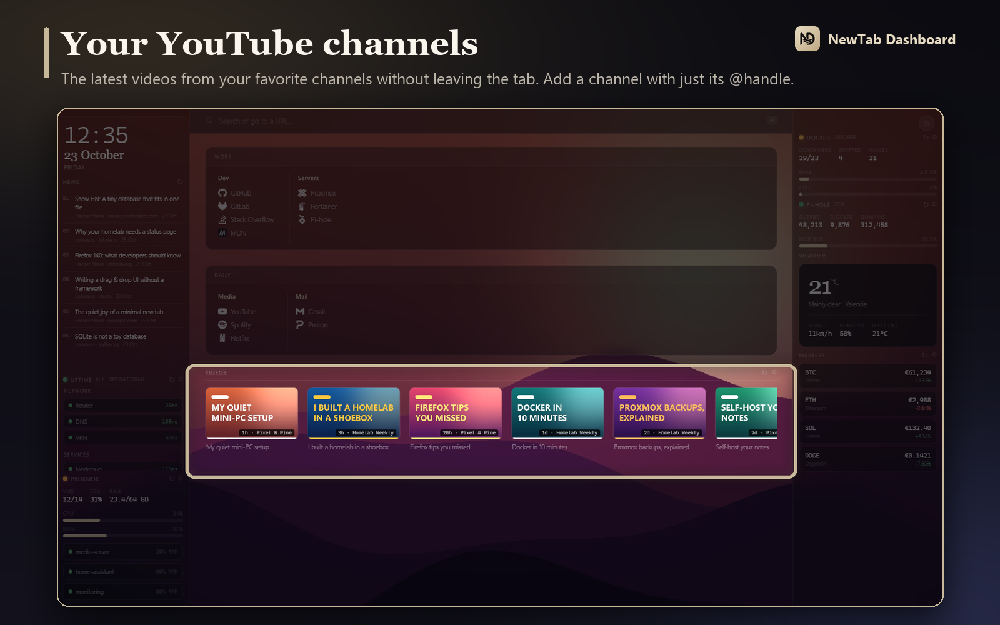</p>

Add a channel with just its `@handle` or Channel ID and watch its latest videos without leaving the tab. Hovering a video shows the **channel name**.

### Real-time markets

<p align="center">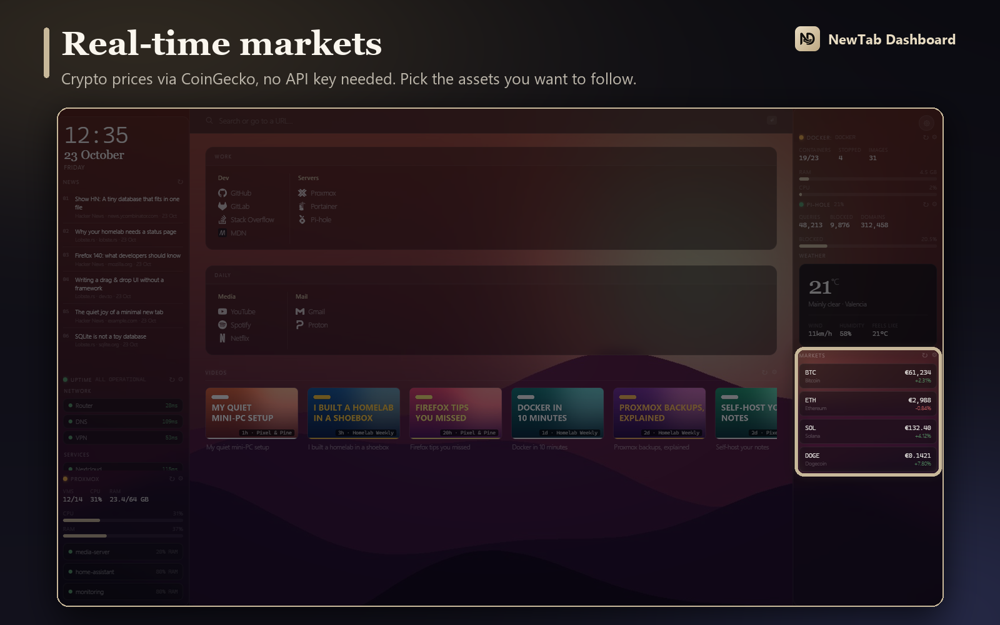</p>

Cryptocurrency prices via CoinGecko, with the 24-hour change. Pick your assets from the popular list or type their ID.

### Your homelab at a glance

<p align="center">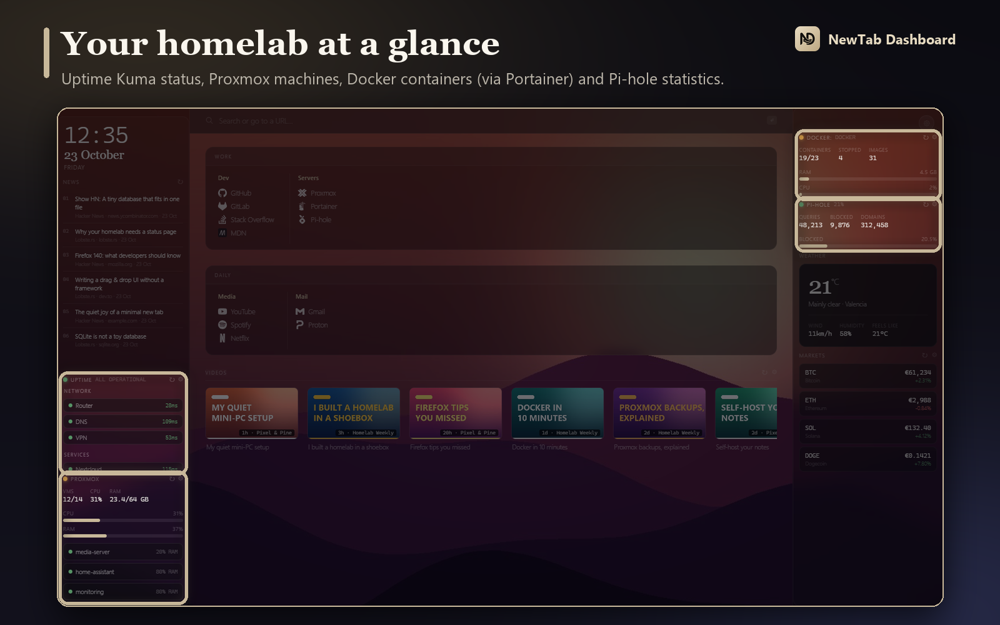</p>

| Service | What it shows | How it connects |
|---|---|---|
| **Uptime Kuma** | Global status and monitors, in extended or compact layout | Your public *status page* URL, no credentials |
| **Proxmox VE** | Running VMs and containers, host CPU and RAM, and the machines you pick | Read-only API Token |
| **Docker** | Running and stopped containers, images, CPU and RAM usage | **Portainer** API Key |
| **Pi-hole v6** | Queries, blocked, % blocked and domains | App password |

Requests go **straight from your browser to your servers**. Credentials are never written to the export file.

### Widgets, your way

<p align="center">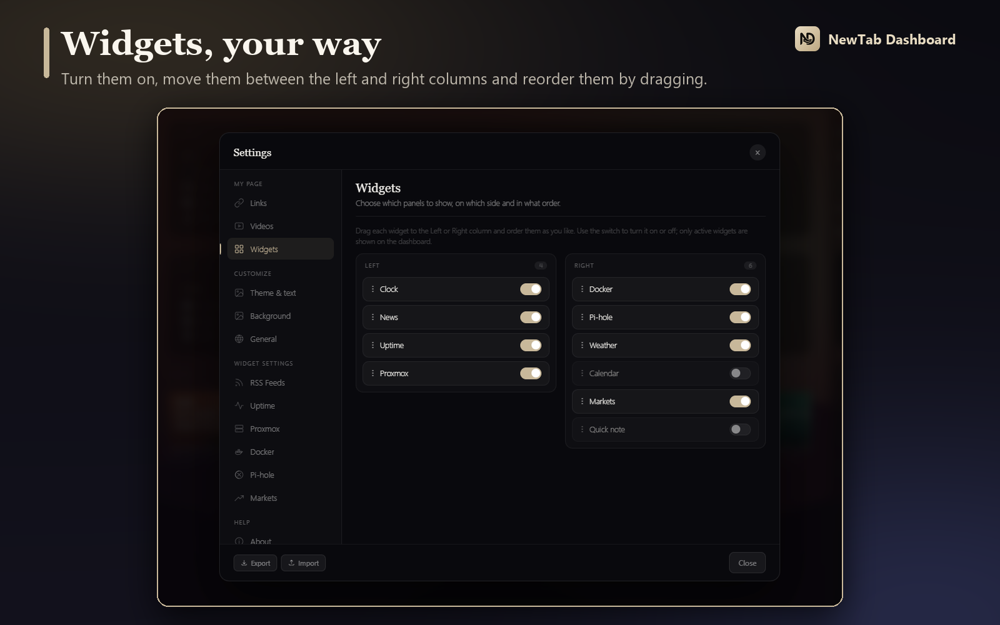</p>

Turn each widget on or off, **drag it between the left and right columns** and order it as you like. The **weather** location is set by searching for your city (⚙ on the widget itself), and it shows thin-line **animated** icons: sun, moon, clouds, fog, rain, snow and thunderstorms with lightning.

### Themes and text

<p align="center">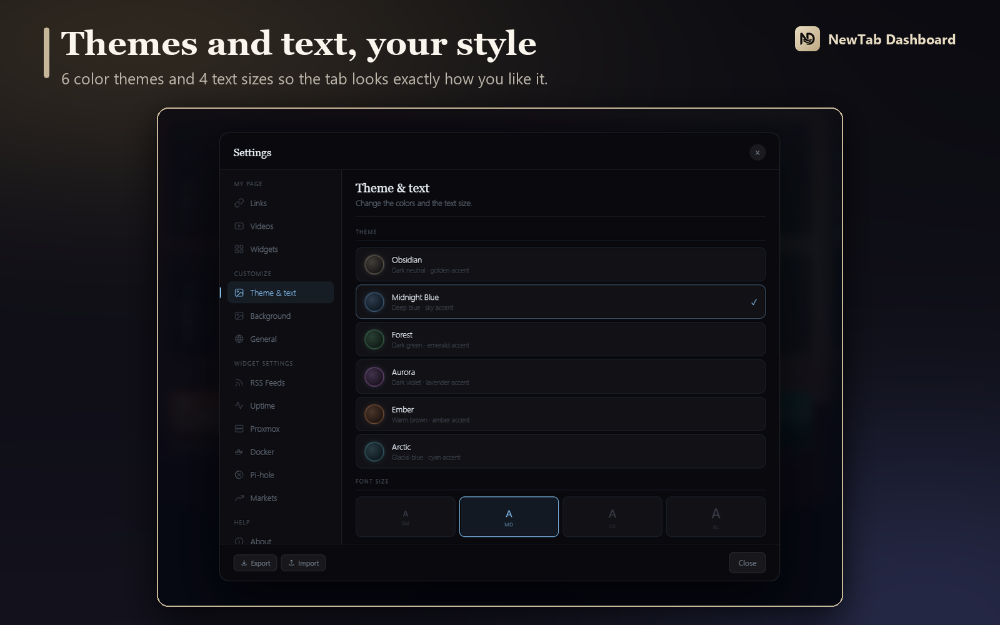</p>

**6 color themes** (Obsidian, Midnight Blue, Forest, Aurora, Ember and Arctic) and **4 text sizes**.

### Get started in seconds

<p align="center">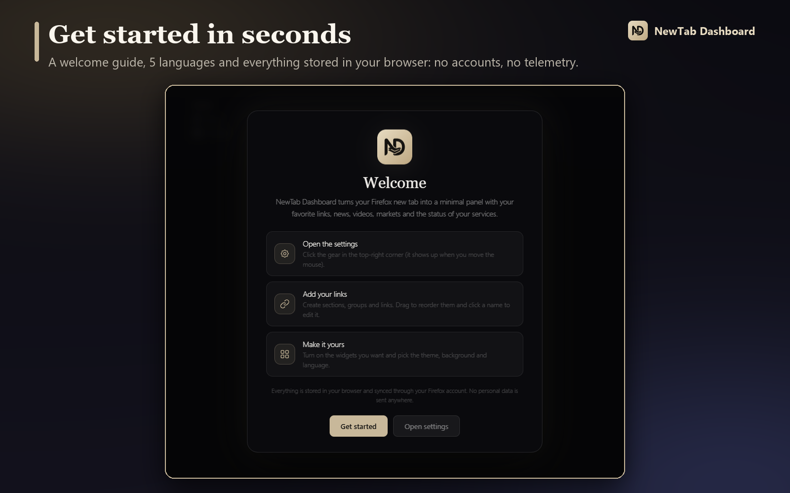</p>

A short welcome guide explains how to set it up the first time. The interface comes in **Spanish, English, Russian, French and German**, and follows your Firefox language.

---

<a id="features"></a>
## ✨ Features

| | |
|---|---|
| 🔒 **Private** | No servers of its own, no accounts and no telemetry. Your settings live in your browser |
| 🔄 **Firefox Sync** | Your settings sync across your devices automatically |
| 🔑 **No API keys** | Weather, cryptocurrencies and YouTube videos work without signing up for anything |
| 🖱️ **Drag & drop** | For links, groups, sections, channels, feeds, assets and widgets |
| 🧭 **Toolbar menu** | Your links in a Firefox drop-down, with search and keyboard support |
| 🖼️ **Backgrounds** | URL, Bing daily, Wallhaven and gradients, with adjustable effects |
| 🧩 **Widgets** | Clock, news, weather, calendar, markets, notes, Uptime Kuma, Proxmox, Docker and Pi-hole |
| 🔎 **Search** | 8 configurable engines (Google, DuckDuckGo, Brave, Kagi, Perplexity…). Press `/` to jump to the search bar |
| 📦 **Import / Export** | Save and restore your whole configuration as JSON |
| 🌍 **5 languages** | Spanish, English, Russian, French and German |
| ⚡ **Lightweight** | Vanilla JS, no frameworks or bundler. Open source under the MIT license |

---

<a id="install"></a>
## 📥 Install

### From the store (recommended)

Install it from the **Firefox Add-ons Store**:

**https://addons.mozilla.org/en-US/firefox/addon/newtab-dashboard/**

### From source (developer mode)

1. Clone or download this repository.
2. Open Firefox and go to `about:debugging`.
3. Click **"This Firefox"** → **"Load Temporary Add-on…"**.
4. Select the `manifest.json` file in the project folder.

> Temporary extensions are disabled when Firefox closes. Use the store for a permanent install.

Every [release](https://github.com/fmartineze/newtab-dashboard/releases) also includes an `.xpi` meant for development: it is **not signed by Mozilla**.

---

<a id="first-steps"></a>
## 🚀 First steps

1. **Open a new tab.** The first time you'll see the welcome guide.
2. **Click ⚙** (top-right corner; it shows up when you move the mouse) to open the settings.
3. In **Links**, create your sections and groups and add your links. Drag to reorder them.
4. In **Widgets**, turn on what you want to see and place it in the left or right column.
5. Under **Customize**, pick the theme, the background and the language.
6. **Pin the menu icon** to the toolbar: Extensions button (the puzzle piece) → “⋯” next to the extension → *Pin to Toolbar*.

---

<a id="customization"></a>
## 🎛️ Customization

Everything is configured from the **⚙** button, no code editing needed:

- **Links**: sections, groups and links (add, edit, reorder, delete) and the toolbar menu switch
- **Videos**: YouTube channels by Channel ID or `@handle`
- **Widgets**: turn them on, move them between columns and order them
- **Theme & text**: 6 themes and 4 text sizes
- **Background**: source, image and effects
- **General**: search engine and language
- **Widget settings**: RSS feeds, Uptime Kuma, Proxmox, Docker, Pi-hole, weather and markets
- **Export / import** the whole configuration
- **About**: version, what's new and license

To change the weather city, go to **Settings → Weather** (or click the widget's gear) and search for your city.

---

<a id="tech"></a>
## 🧱 Tech

| Layer | Detail |
|---|---|
| Storage | `browser.storage.sync` (Firefox Sync) with a fallback to `localStorage` |
| Weather | [Open-Meteo](https://open-meteo.com/) (forecast and city search): free, no API key |
| Crypto | [CoinGecko API](https://www.coingecko.com/en/api): free, no API key |
| YouTube | Direct Atom XML feed, no Google API key |
| RSS | [rss2json](https://rss2json.com/) CORS proxy |
| Icons | [Simple Icons](https://simpleicons.org/) CDN, with the favicon as a fallback |
| Uptime | [Uptime Kuma](https://github.com/louislam/uptime-kuma) public status page |

<details>
<summary><b>Project structure</b></summary>

```
newtab-dashboard/
├── manifest.json      — extension configuration (Manifest v2)
├── dashboard.html     — new tab structure
├── dashboard.css      — styles (glassmorphism, CSS variables, themes, backgrounds)
├── dashboard.js       — the dashboard logic (Vanilla JS)
├── popup.html / popup.css / popup.js
│                      — toolbar links menu
├── background.js      — state of the toolbar button (active / inactive)
├── icon.svg / icon16.png / icon32.png / icon48.png / icon128.png
├── images/            — README screenshots and animations
├── LICENSE            — MIT license
└── README.md
```

</details>

---

<a id="contributors"></a>
## 🤝 Contributors

Thanks to everyone who has contributed; the full list is in [CONTRIBUTORS.md](CONTRIBUTORS.md).

- **[@Nikitamce](https://github.com/Nikitamce)**: Russian translation and internationalization (i18n).

---

## 📄 License

[MIT](LICENSE) © Francisco Martínez. Free and open source software: you may use, modify and redistribute it without restrictions, keeping the copyright notice.

<div align="center">

<br>

**Like it? Leave a ⭐ on the repository and [rate it on the Firefox store](https://addons.mozilla.org/en-US/firefox/addon/newtab-dashboard/).**

</div>
