<div align="center">


# NewTab Dashboard

**Tu nueva pestaña de Firefox, por fin útil.**<br>
Enlaces, noticias, vídeos, mercados, el tiempo y el estado de tu homelab en un panel minimalista y totalmente configurable.

<br>

[](https://addons.mozilla.org/es-ES/firefox/addon/newtab-dashboard/)

[](https://github.com/fmartineze/newtab-dashboard/releases/latest)
[](LICENSE)


[🇷🇺 Русский](README.ru.md) · [🇬🇧 English](README.en.md) · **🇪🇸 Español**

<br>

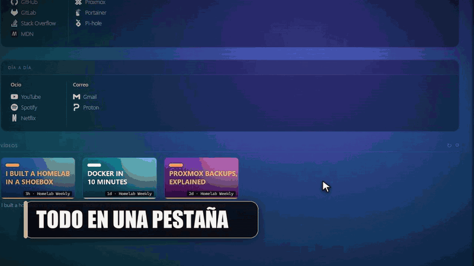

</div>

<br>

<p align="center">
  <a href="#que-es">Qué es</a> ·
  <a href="#recorrido">Recorrido</a> ·
  <a href="#caracteristicas">Características</a> ·
  <a href="#instalacion">Instalación</a> ·
  <a href="#primeros-pasos">Primeros pasos</a> ·
  <a href="#personalizacion">Personalización</a> ·
  <a href="#tecnologia">Tecnología</a>
</p>

---

<a id="que-es"></a>
## 🧭 Qué es

**NewTab Dashboard** reemplaza la nueva pestaña de Firefox por un panel personal, elegante y minimalista donde tienes a mano todo lo que consultas cada día. Funciona entero en tu navegador: **sin servidores propios, sin cuentas, sin API keys y sin telemetría**.

<table>
  <tr>
    <td width="33%" valign="top">
      <h4>🔗 Tus enlaces</h4>
      Secciones → grupos → links que reordenas <b>arrastrando</b>, con iconos automáticos.
    </td>
    <td width="33%" valign="top">
      <h4>🧭 Menú en la barra</h4>
      Un icono de Firefox abre tus links organizados, con <b>búsqueda</b> y teclado.
    </td>
    <td width="33%" valign="top">
      <h4>🖼️ Cualquier fondo</h4>
      Degradados, <b>Wallhaven</b>, el fondo del día de <b>Bing</b> o tu propia imagen.
    </td>
  </tr>
  <tr>
    <td valign="top">
      <h4>▶️ YouTube</h4>
      Los últimos vídeos de tus canales, sin API key de Google.
    </td>
    <td valign="top">
      <h4>📈 Mercados y 🌦️ tiempo</h4>
      Precios cripto en vivo y un clima con <b>iconos animados</b> de tu ciudad.
    </td>
    <td valign="top">
      <h4>🖥️ Tu homelab</h4>
      <b>Uptime Kuma</b>, <b>Proxmox</b>, <b>Docker</b> (Portainer) y <b>Pi-hole</b> de un vistazo.
    </td>
  </tr>
</table>

---

<a id="recorrido"></a>
## 📸 Recorrido

### Todo en una sola pestaña

<p align="center">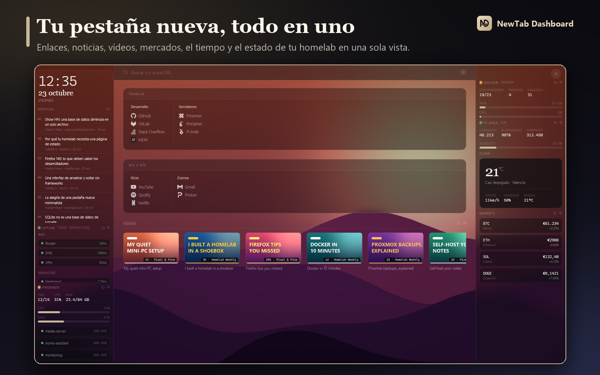</p>

El dashboard se organiza en tres columnas:

| | |
|---|---|
| **Izquierda** | Reloj y fecha, **noticias RSS** y los monitores de tu homelab (Uptime Kuma, Proxmox) |
| **Centro** | Barra de búsqueda con 8 motores, tus **links** por secciones y grupos, y los **vídeos** de YouTube |
| **Derecha** | **Clima**, calendario, **mercados**, Docker, Pi-hole y un bloc de notas |

Y es *tuyo*: cada widget se activa, se desactiva y se coloca donde quieras.

### Tus links, a tu manera

<p align="center">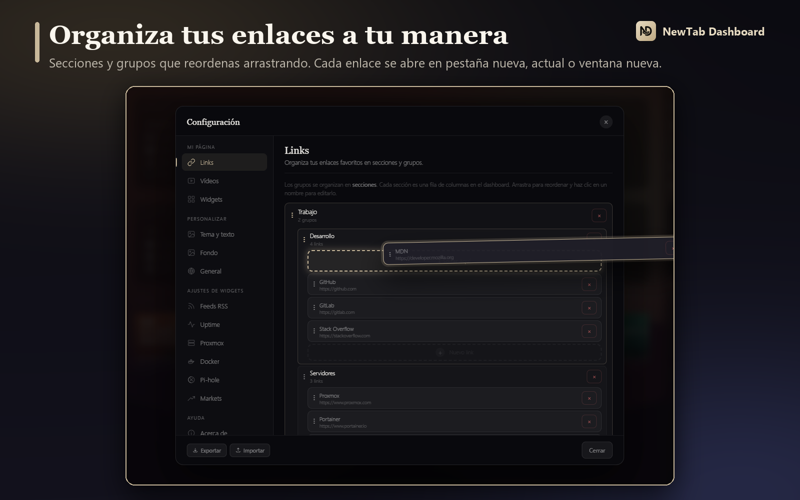</p>

- Estructura clara: **Secciones → Grupos → Links**, con iconos automáticos.
- **Arrastra y suelta** para ordenar links, grupos y secciones: se abre un hueco animado donde caerá. También puedes mover un link a otro grupo.
- **Un clic en el nombre** para editarlo. Los huecos con borde discontinuo indican dónde se puede añadir algo.
- Cada link se abre donde tú elijas: **pestaña nueva, pestaña actual o ventana nueva**.

### Menú en la barra de Firefox

<p align="center">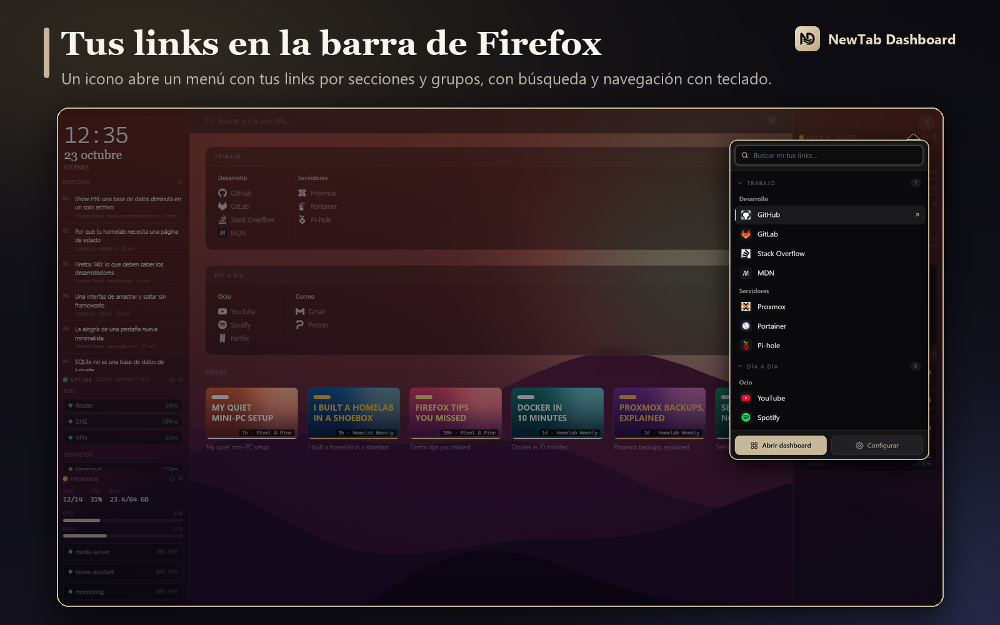</p>

- Un **icono en la barra de herramientas** abre un menú con tus links organizados por secciones y grupos (las secciones se pliegan y recuerdan su estado).
- **Buscador** con el foco al abrir: filtra por nombre, dirección, grupo o sección y resalta lo encontrado.
- **Teclado**: `↑` `↓` para recorrer, `Enter` para abrir, `Esc` para borrar la búsqueda o cerrar; basta con empezar a escribir.
- `Mayús`+clic abre una ventana nueva; `Ctrl`+clic o clic central abren en segundo plano sin cerrar el menú.
- Se activa o desactiva con el interruptor de **Configuración → Links**, que incluye las instrucciones para fijar el icono en la barra.

### Cualquier fondo, en un clic

<p align="center">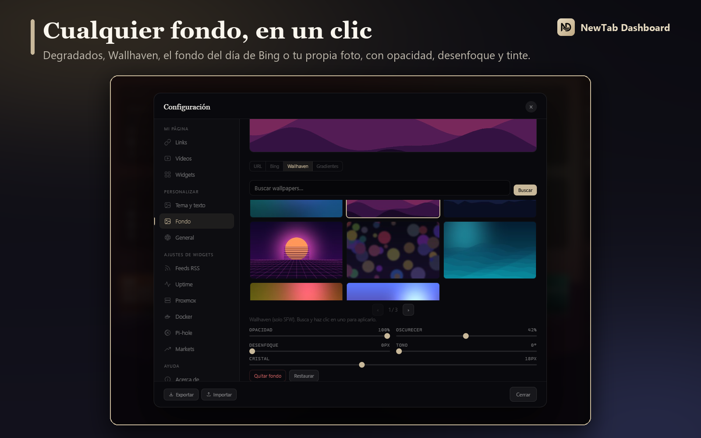</p>

**Degradados** predefinidos, la galería de **Wallhaven** (solo contenido apto), la imagen diaria de **Bing** o la URL de tu propia imagen, con controles de opacidad, oscurecimiento, desenfoque, tono y cristal.

### Tus canales de YouTube

<p align="center">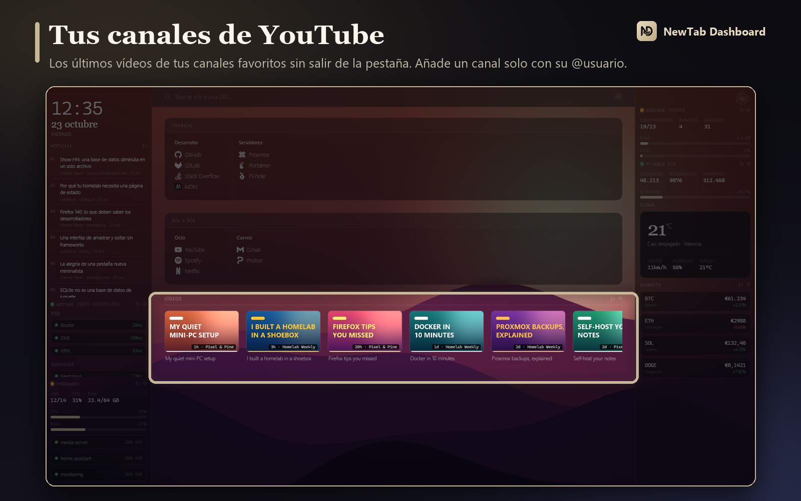</p>

Añade un canal solo con su `@usuario` o su Channel ID y mira sus últimos vídeos sin salir de la pestaña. Al pasar el cursor por un vídeo aparece el **nombre del canal**.

### Mercados en tiempo real

<p align="center">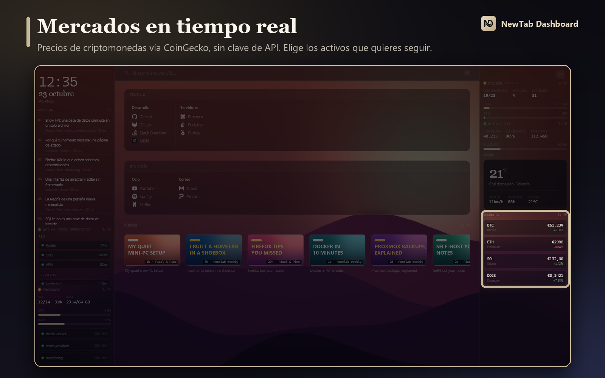</p>

Precios de criptomonedas vía CoinGecko, con la variación de 24 h. Elige tus activos con la lista de populares o escribe su ID.

### Tu homelab de un vistazo

<p align="center">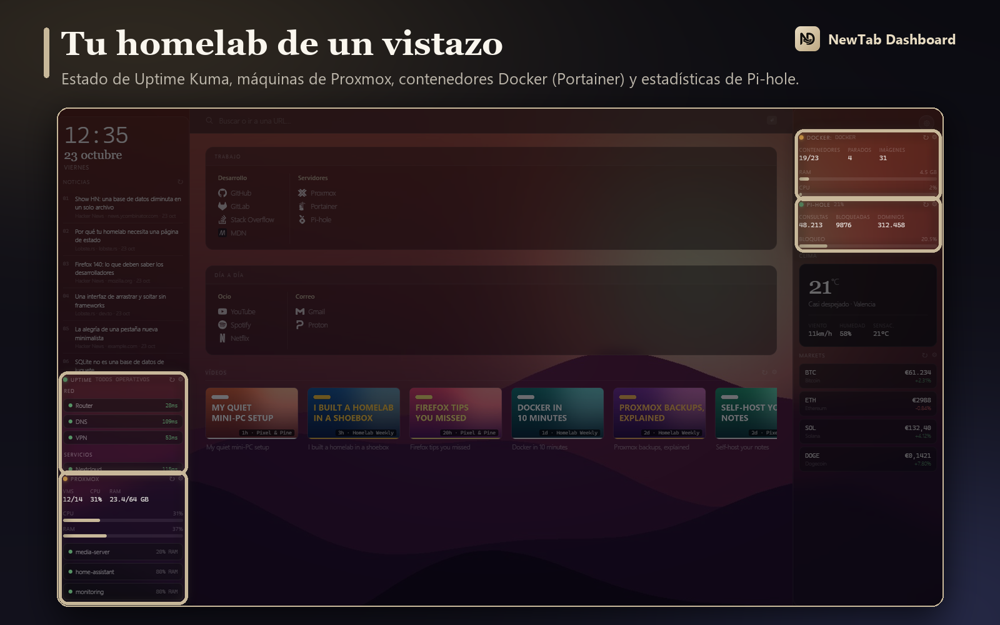</p>

| Servicio | Qué muestra | Cómo se conecta |
|---|---|---|
| **Uptime Kuma** | Estado global y monitores, en modo extendido o compacto | URL de tu *status page* pública, sin credenciales |
| **Proxmox VE** | VMs y contenedores activos, CPU y RAM del host, y las máquinas que elijas | API Token de solo lectura |
| **Docker** | Contenedores en marcha y parados, imágenes, uso de CPU y RAM | API Key de **Portainer** |
| **Pi-hole v6** | Consultas, bloqueadas, % de bloqueo y dominios | Contraseña de aplicación |

Las consultas van **directamente de tu navegador a tus servidores**. Las credenciales no se escriben nunca en el archivo de exportación.

### Widgets a tu medida

<p align="center">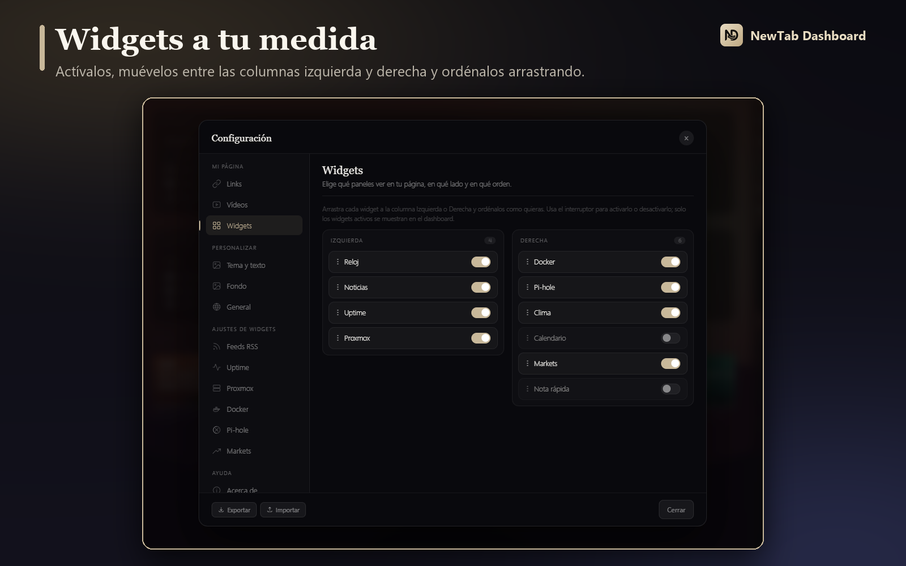</p>

Activa o desactiva cada widget, **arrástralo entre la columna izquierda y la derecha** y ordénalo a tu gusto. El **clima** se elige buscando tu ciudad (⚙ en el propio widget) y muestra iconos de trazo fino **animados**: sol, luna, nubes, niebla, lluvia, nieve y tormentas con relámpagos.

### Temas y texto

<p align="center">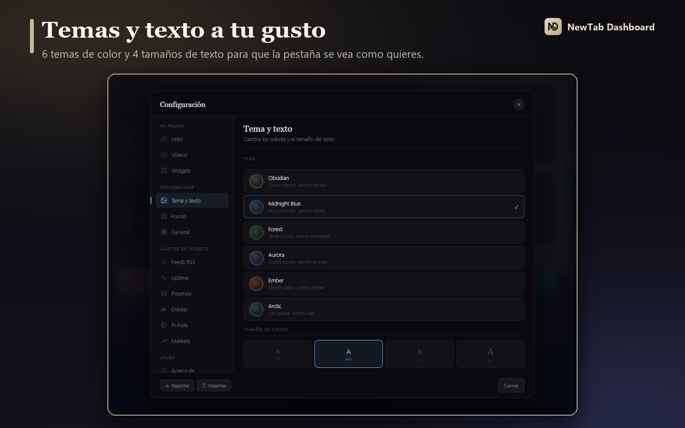</p>

**6 temas** de color (Obsidian, Midnight Blue, Forest, Aurora, Ember y Arctic) y **4 tamaños de texto**.

### Empieza en segundos

<p align="center">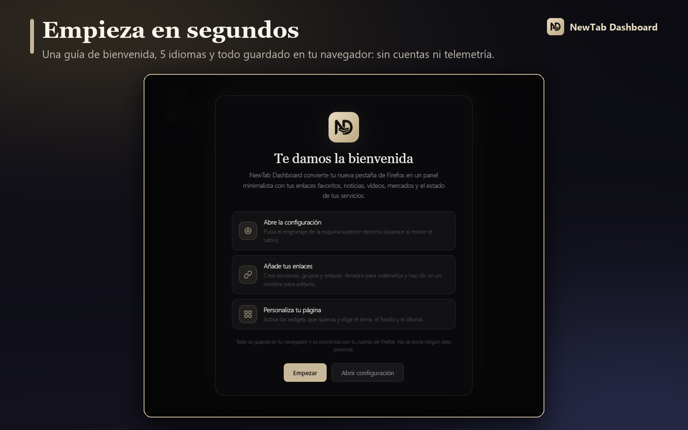</p>

Una breve guía de bienvenida te explica cómo configurarlo la primera vez. La interfaz está en **español, inglés, ruso, francés y alemán**, y se adapta al idioma de tu Firefox.

---

<a id="caracteristicas"></a>
## ✨ Características

| | |
|---|---|
| 🔒 **Privado** | Sin servidores propios, sin cuentas y sin telemetría. Tu configuración vive en tu navegador |
| 🔄 **Firefox Sync** | La configuración se sincroniza entre tus dispositivos automáticamente |
| 🔑 **Sin API keys** | Clima, criptomonedas y vídeos de YouTube funcionan sin registrarte en nada |
| 🖱️ **Arrastrar y soltar** | En links, grupos, secciones, canales, feeds, activos y widgets |
| 🧭 **Menú de la barra** | Tus links en un desplegable de Firefox, con búsqueda y teclado |
| 🖼️ **Fondos** | URL, Bing diario, Wallhaven y degradados, con efectos ajustables |
| 🧩 **Widgets** | Reloj, noticias, clima, calendario, mercados, notas, Uptime Kuma, Proxmox, Docker y Pi-hole |
| 🔎 **Buscador** | 8 motores configurables (Google, DuckDuckGo, Brave, Kagi, Perplexity…). Pulsa `/` para ir a la búsqueda |
| 📦 **Importar / Exportar** | Guarda y restaura toda tu configuración en un JSON |
| 🌍 **5 idiomas** | Español, inglés, ruso, francés y alemán |
| ⚡ **Ligero** | Vanilla JS, sin frameworks ni *bundler*. Código abierto con licencia MIT |

---

<a id="instalacion"></a>
## 📥 Instalación

### Desde la tienda (recomendado)

Instálalo desde la **Firefox Add-ons Store**:

**https://addons.mozilla.org/es-ES/firefox/addon/newtab-dashboard/**

### Desde el código fuente (modo desarrollador)

1. Clona o descarga este repositorio.
2. Abre Firefox y ve a `about:debugging`.
3. Pulsa **"Este Firefox"** → **"Cargar complemento temporal…"**.
4. Selecciona el archivo `manifest.json` de la carpeta del proyecto.

> Las extensiones temporales se desactivan al cerrar Firefox. Para una instalación permanente usa la tienda.

También hay un `.xpi` en cada [release](https://github.com/fmartineze/newtab-dashboard/releases), pensado para desarrollo: **no está firmado por Mozilla**.

---

<a id="primeros-pasos"></a>
## 🚀 Primeros pasos

1. **Abre una pestaña nueva.** La primera vez verás la guía de bienvenida.
2. **Pulsa ⚙** (esquina superior derecha; aparece al mover el ratón) para abrir la configuración.
3. En **Links**, crea tus secciones y grupos y añade tus enlaces. Arrastra para ordenarlos.
4. En **Widgets**, activa lo que quieras ver y colócalo en la columna izquierda o derecha.
5. En **Personalizar**, elige el tema, el fondo y el idioma.
6. **Fija el icono del menú** en la barra: botón de Extensiones (la pieza de puzle) → «⋯» junto a la extensión → *Fijar en la barra de herramientas*.

---

<a id="personalizacion"></a>
## 🎛️ Personalización

Todo se configura desde el botón **⚙**, sin tocar código:

- **Links**: secciones, grupos y enlaces (añadir, editar, reordenar, eliminar) y el interruptor del menú de la barra
- **Vídeos**: canales de YouTube por Channel ID o `@handle`
- **Widgets**: activarlos, moverlos entre columnas y ordenarlos
- **Tema y texto**: 6 temas y 4 tamaños de texto
- **Fondo**: fuente, imagen y efectos
- **General**: motor de búsqueda e idioma
- **Ajustes de widgets**: feeds RSS, Uptime Kuma, Proxmox, Docker, Pi-hole, clima y mercados
- **Exportar / importar** la configuración completa
- **Acerca de**: versión, novedades y licencia

Para cambiar la ciudad del clima, ve a **Configuración → Clima** (o pulsa el engranaje del widget) y busca tu ciudad.

---

<a id="tecnologia"></a>
## 🧱 Tecnología

| Capa | Detalle |
|---|---|
| Almacenamiento | `browser.storage.sync` (Firefox Sync) con *fallback* a `localStorage` |
| Clima | [Open-Meteo](https://open-meteo.com/) (previsión y búsqueda de ciudades): gratuito, sin API key |
| Crypto | [CoinGecko API](https://www.coingecko.com/en/api): gratuito, sin API key |
| YouTube | Feed Atom XML directo, sin Google API key |
| RSS | Proxy CORS [rss2json](https://rss2json.com/) |
| Iconos | [Simple Icons](https://simpleicons.org/) CDN, con el favicon como alternativa |
| Uptime | [Uptime Kuma](https://github.com/louislam/uptime-kuma), *status page* pública |

<details>
<summary><b>Estructura del proyecto</b></summary>

```
newtab-dashboard/
├── manifest.json      — configuración de la extensión (Manifest v2)
├── dashboard.html     — estructura de la nueva pestaña
├── dashboard.css      — estilos (glassmorphism, variables CSS, temas, fondos)
├── dashboard.js       — la lógica del dashboard (Vanilla JS)
├── popup.html / popup.css / popup.js
│                      — menú de links de la barra de herramientas
├── background.js      — estado del botón de la barra (activo / inactivo)
├── icon.svg / icon16.png / icon32.png / icon48.png / icon128.png
├── images/            — capturas y animación del README
├── LICENSE            — licencia MIT
└── README.md
```

</details>

---

<a id="colaboradores"></a>
## 🤝 Colaboradores

Gracias a quienes han contribuido; la lista completa está en [CONTRIBUTORS.md](CONTRIBUTORS.md).

- **[@Nikitamce](https://github.com/Nikitamce)**: traducción al ruso e internacionalización (i18n).

---

## 📄 Licencia

[MIT](LICENSE) © Francisco Martínez. Software libre y gratuito: puedes usarlo, modificarlo y redistribuirlo sin restricciones, conservando el aviso de copyright.

<div align="center">

<br>

**¿Te gusta? Deja una ⭐ en el repositorio y [valóralo en la tienda de Firefox](https://addons.mozilla.org/es-ES/firefox/addon/newtab-dashboard/).**

</div>
