<div align="center">


# NewTab Dashboard

**Ваша новая вкладка Firefox — наконец-то полезная.**<br>
Ссылки, новости, видео, рынки, погода и состояние вашей домашней лаборатории в минималистичной и полностью настраиваемой панели.

<br>

[](https://addons.mozilla.org/ru/firefox/addon/newtab-dashboard/)

[](https://github.com/fmartineze/newtab-dashboard/releases/latest)
[](LICENSE)


**🇷🇺 Русский** · [🇬🇧 English](README.en.md) · [🇪🇸 Español](README.md)

<br>

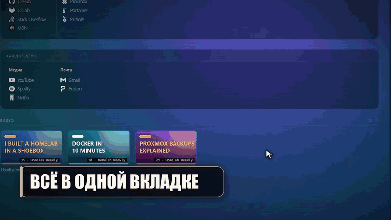

</div>

<br>

<p align="center">
  <a href="#chto-eto">Что это</a> ·
  <a href="#obzor">Обзор</a> ·
  <a href="#vozmozhnosti">Возможности</a> ·
  <a href="#ustanovka">Установка</a> ·
  <a href="#pervye-shagi">Первые шаги</a> ·
  <a href="#nastroyka">Настройка</a> ·
  <a href="#tehnologii">Технологии</a>
</p>

---

<a id="chto-eto"></a>
## 🧭 Что это

**NewTab Dashboard** заменяет новую вкладку Firefox элегантной минималистичной личной панелью, где под рукой всё, что вы смотрите каждый день. Всё работает прямо в браузере: **без собственных серверов, без аккаунтов, без API-ключей и без телеметрии**.

<table>
  <tr>
    <td width="33%" valign="top">
      <h4>🔗 Ваши ссылки</h4>
      Разделы → группы → ссылки, порядок которых меняется <b>перетаскиванием</b>, с автоматическими значками.
    </td>
    <td width="33%" valign="top">
      <h4>🧭 Меню на панели</h4>
      Значок Firefox открывает ваши ссылки по порядку, с <b>поиском</b> и управлением с клавиатуры.
    </td>
    <td width="33%" valign="top">
      <h4>🖼️ Любой фон</h4>
      Градиенты, <b>Wallhaven</b>, обои дня <b>Bing</b> или ваша собственная картинка.
    </td>
  </tr>
  <tr>
    <td valign="top">
      <h4>▶️ YouTube</h4>
      Свежие видео ваших каналов, без ключа Google API.
    </td>
    <td valign="top">
      <h4>📈 Рынки и 🌦️ погода</h4>
      Цены криптовалют в реальном времени и погода в вашем городе с <b>анимированными значками</b>.
    </td>
    <td valign="top">
      <h4>🖥️ Ваша домашняя лаборатория</h4>
      <b>Uptime Kuma</b>, <b>Proxmox</b>, <b>Docker</b> (Portainer) и <b>Pi-hole</b> с первого взгляда.
    </td>
  </tr>
</table>

---

<a id="obzor"></a>
## 📸 Обзор

### Всё в одной вкладке

<p align="center">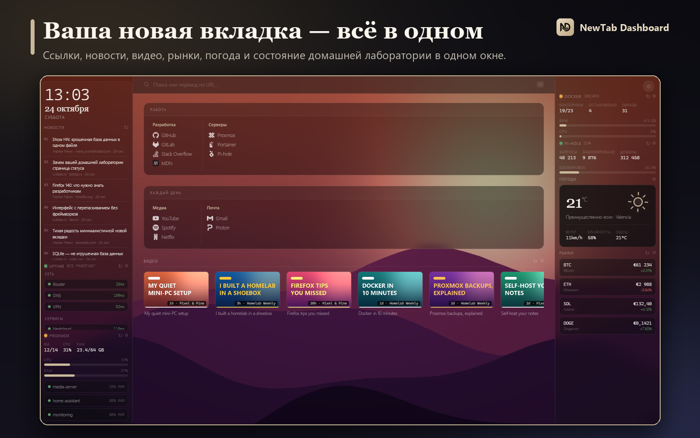</p>

Панель разделена на три колонки:

| | |
|---|---|
| **Слева** | Часы и дата, **RSS-новости** и мониторы вашей лаборатории (Uptime Kuma, Proxmox) |
| **По центру** | Строка поиска с 8 поисковиками, ваши **ссылки** по разделам и группам и **видео** YouTube |
| **Справа** | **Погода**, календарь, **рынки**, Docker, Pi-hole и блокнот |

И она *ваша*: каждый виджет можно включить, отключить и поставить куда угодно.

### Ваши ссылки — по-вашему

<p align="center">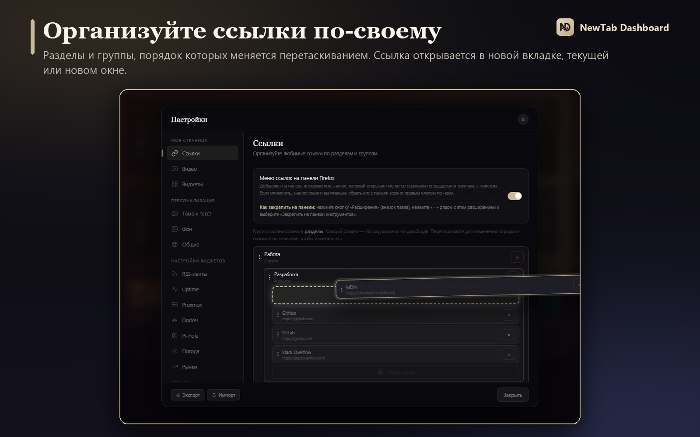</p>

- Понятная структура: **разделы → группы → ссылки**, с автоматическими значками.
- **Перетаскивайте**, чтобы менять порядок ссылок, групп и разделов: на месте, куда упадёт элемент, открывается анимированный промежуток. Ссылку можно перенести и в другую группу.
- **Нажмите на название**, чтобы изменить его. Пунктирные ячейки показывают, где можно что-то добавить.
- Каждая ссылка открывается там, где вы выберете: **в новой вкладке, в текущей или в новом окне**.

### Меню на панели Firefox

<p align="center">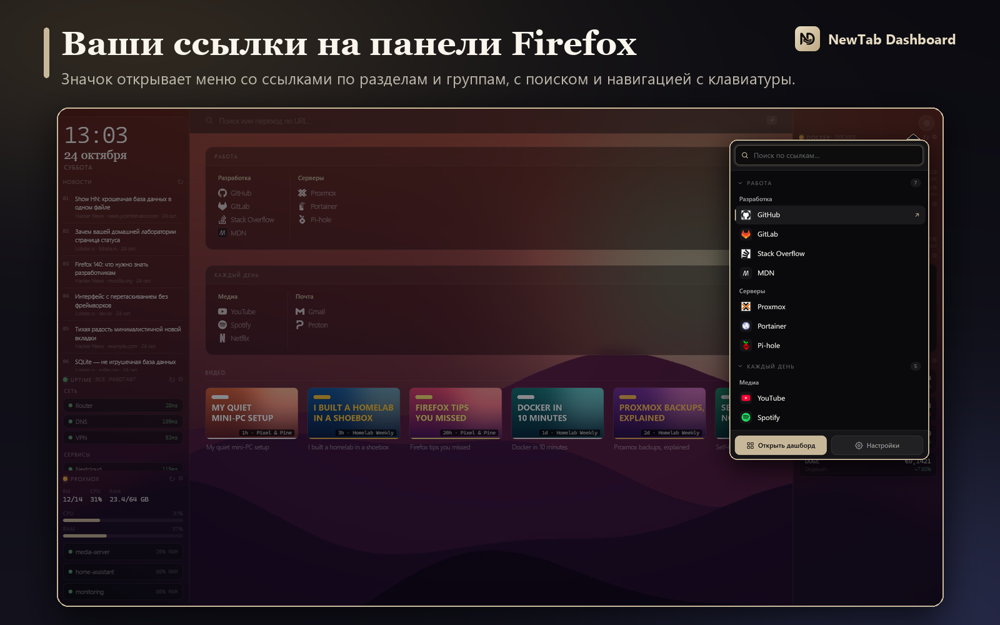</p>

- **Значок на панели инструментов** открывает меню с вашими ссылками по разделам и группам (разделы сворачиваются и запоминают своё состояние).
- **Поиск** сразу в фокусе: фильтрует по названию, адресу, группе или разделу и подсвечивает найденное.
- **Клавиатура**: `↑` `↓` для перемещения, `Enter` для открытия, `Esc` — очистить поиск или закрыть; можно просто начать печатать.
- `Shift`+клик открывает новое окно; `Ctrl`+клик или клик средней кнопкой — вкладку в фоне, не закрывая меню.
- Включается и отключается переключателем в **Настройки → Ссылки**, где также объясняется, как закрепить значок на панели.

### Любой фон — в один клик

<p align="center">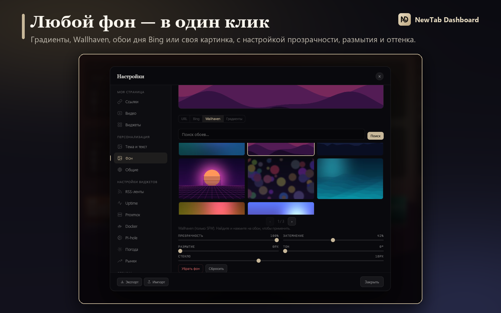</p>

Готовые **градиенты**, галерея **Wallhaven** (только безопасный контент), обои дня **Bing** или адрес вашей картинки, с настройкой прозрачности, затемнения, размытия, оттенка и «стекла».

### Ваши каналы YouTube

<p align="center">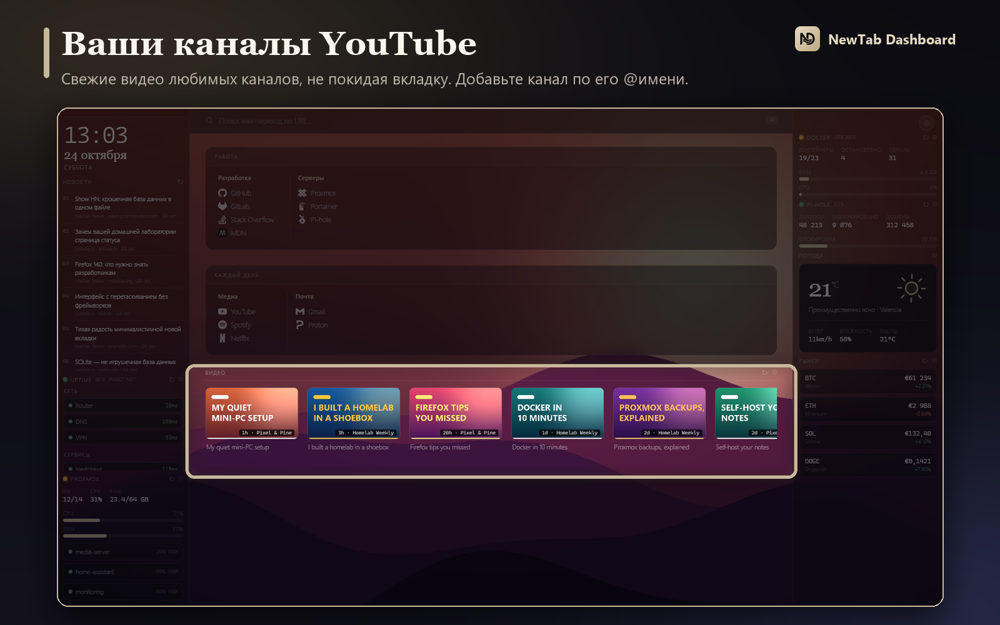</p>

Добавьте канал по его `@имени` или Channel ID и смотрите свежие видео, не покидая вкладку. При наведении на видео появляется **название канала**.

### Рынки в реальном времени

<p align="center">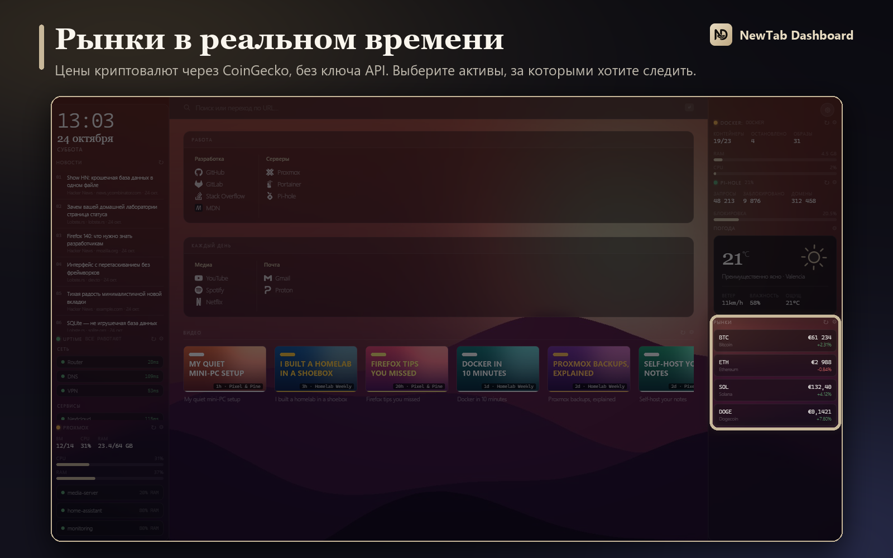</p>

Цены криптовалют через CoinGecko и изменение за 24 часа. Выбирайте активы из списка популярных или вводите их ID.

### Ваша домашняя лаборатория с первого взгляда

<p align="center">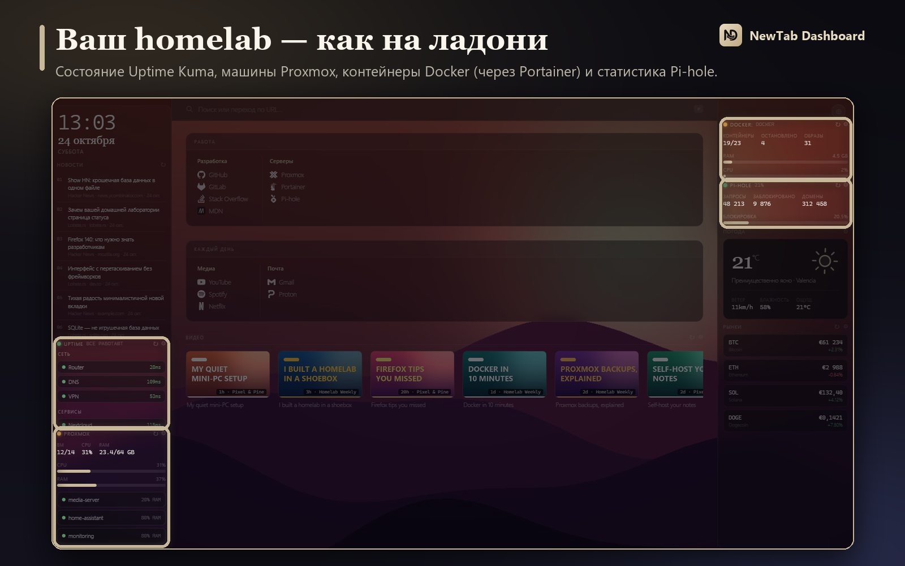</p>

| Сервис | Что показывает | Как подключается |
|---|---|---|
| **Uptime Kuma** | Общее состояние и мониторы, в развёрнутом или компактном виде | Адрес вашей публичной *status page*, без учётных данных |
| **Proxmox VE** | Запущенные ВМ и контейнеры, CPU и RAM хоста и выбранные вами машины | API Token только для чтения |
| **Docker** | Работающие и остановленные контейнеры, образы, использование CPU и RAM | API Key от **Portainer** |
| **Pi-hole v6** | Запросы, заблокированные, % блокировки и домены | Пароль приложения |

Запросы идут **напрямую из вашего браузера на ваши серверы**. Учётные данные никогда не попадают в файл экспорта.

### Виджеты под вас

<p align="center">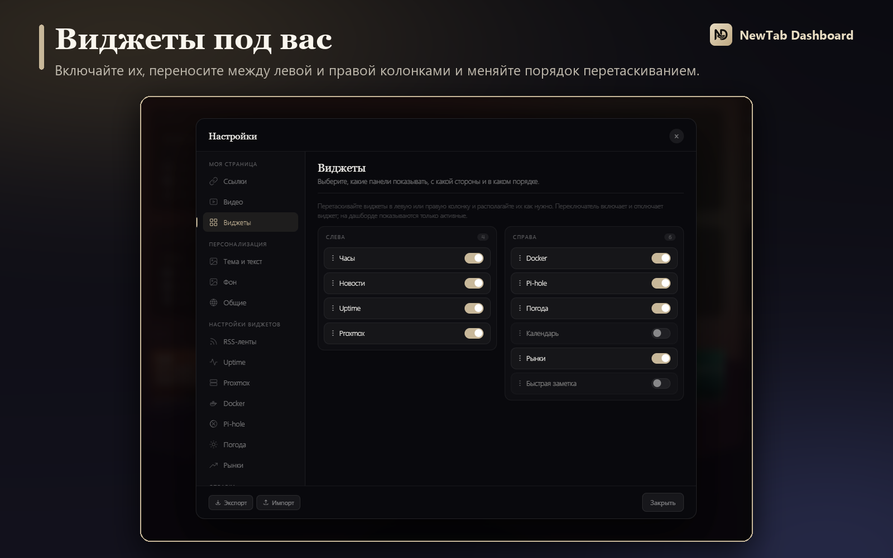</p>

Включайте и отключайте каждый виджет, **переносите его между левой и правой колонками** и меняйте порядок. Город для **погоды** выбирается поиском (⚙ на самом виджете), а значки — тонкие **анимированные**: солнце, луна, облака, туман, дождь, снег и гроза с молниями.

### Темы и текст

<p align="center">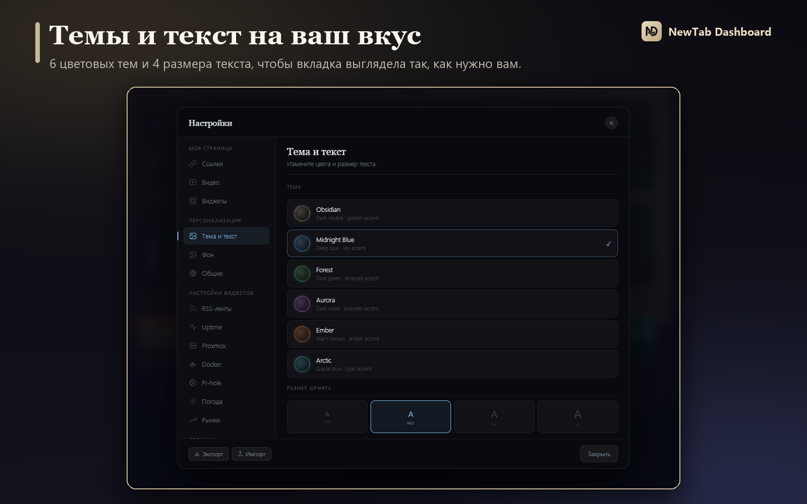</p>

**6 цветовых тем** (Obsidian, Midnight Blue, Forest, Aurora, Ember и Arctic) и **4 размера текста**.

### Начните за секунды

<p align="center">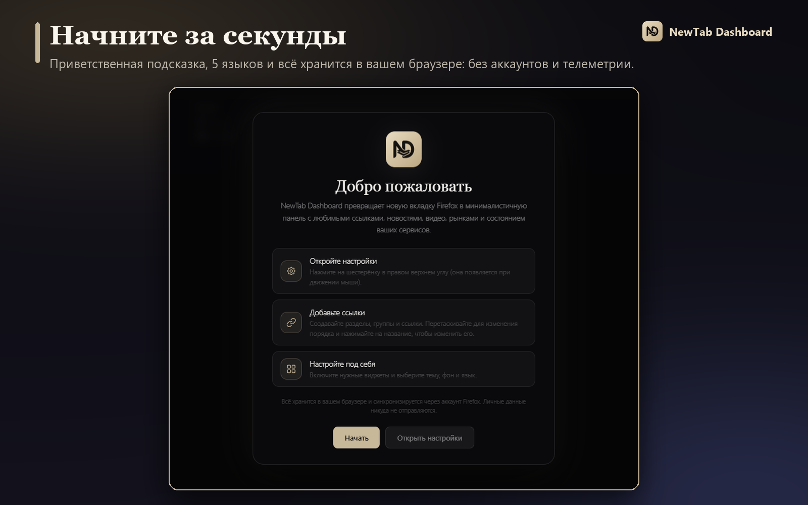</p>

Короткая приветственная подсказка объяснит, как всё настроить в первый раз. Интерфейс доступен на **испанском, английском, русском, французском и немецком** и подстраивается под язык вашего Firefox.

---

<a id="vozmozhnosti"></a>
## ✨ Возможности

| | |
|---|---|
| 🔒 **Приватность** | Без собственных серверов, аккаунтов и телеметрии. Ваши настройки живут в вашем браузере |
| 🔄 **Firefox Sync** | Настройки автоматически синхронизируются между вашими устройствами |
| 🔑 **Без API-ключей** | Погода, криптовалюты и видео YouTube работают без регистрации |
| 🖱️ **Перетаскивание** | Для ссылок, групп, разделов, каналов, лент, активов и виджетов |
| 🧭 **Меню на панели** | Ваши ссылки в выпадающем меню Firefox, с поиском и управлением с клавиатуры |
| 🖼️ **Фоны** | URL, Bing, Wallhaven и градиенты с настраиваемыми эффектами |
| 🧩 **Виджеты** | Часы, новости, погода, календарь, рынки, заметки, Uptime Kuma, Proxmox, Docker и Pi-hole |
| 🔎 **Поиск** | 8 настраиваемых поисковиков (Google, DuckDuckGo, Brave, Kagi, Perplexity…). Нажмите `/`, чтобы перейти к строке поиска |
| 📦 **Импорт / экспорт** | Сохраняйте и восстанавливайте всю конфигурацию в JSON |
| 🌍 **5 языков** | Испанский, английский, русский, французский и немецкий |
| ⚡ **Лёгкость** | Vanilla JS, без фреймворков и сборщика. Открытый код под лицензией MIT |

---

<a id="ustanovka"></a>
## 📥 Установка

### Из магазина (рекомендуется)

Установите из **Firefox Add-ons Store**:

**https://addons.mozilla.org/ru/firefox/addon/newtab-dashboard/**

### Из исходного кода (режим разработчика)

1. Склонируйте или скачайте этот репозиторий.
2. Откройте Firefox и перейдите на `about:debugging`.
3. Нажмите **«Этот Firefox»** → **«Загрузить временное дополнение…»**.
4. Выберите файл `manifest.json` из папки проекта.

> Временные расширения отключаются при закрытии Firefox. Для постоянной установки используйте магазин.

В каждом [релизе](https://github.com/fmartineze/newtab-dashboard/releases) есть также `.xpi` для разработки: он **не подписан Mozilla**.

---

<a id="pervye-shagi"></a>
## 🚀 Первые шаги

1. **Откройте новую вкладку.** В первый раз вы увидите приветственную подсказку.
2. **Нажмите ⚙** (в правом верхнем углу; появляется при движении мыши), чтобы открыть настройки.
3. В разделе **Ссылки** создайте разделы и группы и добавьте свои ссылки. Перетаскивайте их, чтобы изменить порядок.
4. В разделе **Виджеты** включите всё, что хотите видеть, и поставьте в левую или правую колонку.
5. В группе **Персонализация** выберите тему, фон и язык.
6. **Закрепите значок меню** на панели: кнопка «Расширения» (значок пазла) → «⋯» рядом с расширением → *Закрепить на панели инструментов*.

---

<a id="nastroyka"></a>
## 🎛️ Настройка

Всё настраивается кнопкой **⚙**, без правки кода:

- **Ссылки**: разделы, группы и ссылки (добавление, изменение, порядок, удаление) и переключатель меню на панели
- **Видео**: каналы YouTube по Channel ID или `@имени`
- **Виджеты**: включение, перенос между колонками и порядок
- **Тема и текст**: 6 тем и 4 размера текста
- **Фон**: источник, изображение и эффекты
- **Общие**: поисковик и язык
- **Настройки виджетов**: RSS-ленты, Uptime Kuma, Proxmox, Docker, Pi-hole, погода и рынки
- **Экспорт / импорт** всей конфигурации
- **О программе**: версия, что нового и лицензия

Чтобы изменить город для погоды, откройте **Настройки → Погода** (или нажмите на шестерёнку виджета) и найдите свой город.

---

<a id="tehnologii"></a>
## 🧱 Технологии

| Уровень | Подробности |
|---|---|
| Хранение | `browser.storage.sync` (Firefox Sync) с запасным вариантом `localStorage` |
| Погода | [Open-Meteo](https://open-meteo.com/) (прогноз и поиск городов): бесплатно, без API-ключа |
| Крипто | [CoinGecko API](https://www.coingecko.com/en/api): бесплатно, без API-ключа |
| YouTube | Прямая лента Atom XML, без ключа Google API |
| RSS | CORS-прокси [rss2json](https://rss2json.com/) |
| Значки | CDN [Simple Icons](https://simpleicons.org/), с favicon как запасным вариантом |
| Uptime | Публичная status page [Uptime Kuma](https://github.com/louislam/uptime-kuma) |

<details>
<summary><b>Структура проекта</b></summary>

```
newtab-dashboard/
├── manifest.json      — конфигурация расширения (Manifest v2)
├── dashboard.html     — структура новой вкладки
├── dashboard.css      — стили (glassmorphism, CSS-переменные, темы, фоны)
├── dashboard.js       — логика панели (Vanilla JS)
├── popup.html / popup.css / popup.js
│                      — меню ссылок на панели инструментов
├── background.js      — состояние кнопки на панели (активна / неактивна)
├── icon.svg / icon16.png / icon32.png / icon48.png / icon128.png
├── images/            — скриншоты и анимации для README
├── LICENSE            — лицензия MIT
└── README.md
```

</details>

---

<a id="uchastniki"></a>
## 🤝 Участники

Спасибо всем, кто внёс вклад; полный список — в [CONTRIBUTORS.md](CONTRIBUTORS.md).

- **[@Nikitamce](https://github.com/Nikitamce)**: перевод на русский и интернационализация (i18n).

---

## 📄 Лицензия

[MIT](LICENSE) © Francisco Martínez. Свободное программное обеспечение: вы можете использовать, изменять и распространять его без ограничений, сохраняя уведомление об авторских правах.

<div align="center">

<br>

**Нравится? Поставьте ⭐ репозиторию и [оцените расширение в магазине Firefox](https://addons.mozilla.org/ru/firefox/addon/newtab-dashboard/).**

</div>
